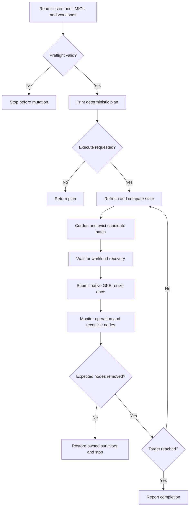

# Design: a GKE-native drain orchestrator

## Problem and scope

Maintenance scale-downs cross two independently changing systems: Kubernetes workload scheduling and cloud VM capacity. A successful eviction does not prove that cloud capacity changed, and a completed cloud resize does not prove that the preferred VMs were the ones removed.

`gke-drain` makes those steps explicit for manually managed GKE Standard node pools. It has a pure planner, an orchestrator behind a small interface, and a REST adapter. The planner and orchestrator can be tested without cloud access.

## Mapping from ECS

| ECS concept | Google Cloud / Kubernetes counterpart | Design consequence |
| --- | --- | --- |
| ECS cluster | GKE Standard cluster | Select project, control-plane location, and cluster explicitly. |
| EC2 container instance | Kubernetes Node backed by a Compute Engine VM | Verify provider ID against the pool's MIG membership. |
| ASG desired capacity | GKE node-pool size | Call `nodePools.setSize`; inspect MIGs read-only. |
| ECS `DRAINING` | Cordon plus `policy/v1` eviction | Wait for Pods to leave; never substitute direct deletion. |
| Service desired task count | Controller replica count | Keep application replica counts unchanged. |
| Exact instance selection | Preferred drained candidates | Compare the actual removals and halt on a mismatch. |
| Instance flip | Native GKE node maintenance / upgrade strategies | Omitted from this scale-down tool. |

GKE owns its node pools' managed instance groups. This implementation follows the documented GKE resize path rather than using Compute writes to obtain stronger-looking victim selection.

## Lifecycle



Errors at each stage follow the recovery rules below. A failed revalidation never advances to a new resize.

## Sizing and selection

GKE applies a node count to every zone in a pool. With three zones, a change from four to two nodes per zone reduces the total from twelve to six. A batch of one per zone first reaches nine total nodes, then six. All zones must start at the same stable size.

The planner obtains current targets from the backing MIGs. `NodePool.initialNodeCount` describes initial configuration and is not used as the current size. Multiple groups in one zone can indicate an upgrade state; ambiguous layouts are refused. Each expected VM must have one matching Kubernetes Node, with no additional nodes in the observed pool.

Within each zone, selection uses a machine-type preference, ordinary Pod count, age, and name. This creates a repeatable preference list, not a scheduling or bin-packing proof. No-op plans at the current size are allowed; scale-ups and zero targets are outside scope.

The initial fingerprint covers the state relevant to the proposed action. Kubernetes resource versions are used when mutating individual nodes, rather than making every harmless heartbeat invalidate a whole plan. The fingerprint is not a signed authorization object and cannot be replayed through a plan-file apply mode.

Execution retains the candidate names and UIDs printed for every batch. It refreshes guarded node fields and repeats safety checks before using them. Pod redistribution can change a hypothetical new ranking after the first drain; that does not silently substitute different candidates into the displayed plan. Changed candidate identity or unexpected capacity stops the run.

## Eviction and workload recovery

The tool checks every ordinary Pod on the pool because GKE may choose a different node during resizing. Pods with no supported controller or host-local data fail preflight. `emptyDir` and PVC use require explicit flags. The PVC flag accepts an operator decision; it does not assess persistent-volume topology.

Candidates are cordoned with an ownership annotation and identity guards. Eviction uses `policy/v1`, includes a Pod UID precondition, and retries budget/rate-limit rejection within a deadline. There is no force-delete fallback. Mirror, DaemonSet, and completed Pods do not count as movable application workload.

Supported controller readiness is checked before capacity reduction and between batches. Controller identity, desired replicas, and generation must remain consistent with the run. Concurrent deployments or horizontal scaling can invalidate that assumption, so the command stops instead of silently treating a changed application as the reviewed workload.

Kubernetes readiness does not measure request success. A live experiment should collect application probes separately.

## Guarantees and limits

| Property | What this implementation provides |
| --- | --- |
| Preview | No resource mutations without `--execute`. |
| Identity | Explicit cloud resource, GKE-derived API endpoint/CA, VM membership checks, and guarded node/Pod changes. |
| Eviction | Kubernetes eviction admission; no direct Pod-delete fallback. |
| Batches | Per-zone target arithmetic and a capped final batch. |
| Completion | Provider-operation monitoring plus observed node reconciliation. |
| Preferred victims | Selection and verification only; the provider controls actual removal. |
| Cancellation | Bounded local waits and safe-stage cleanup; accepted cloud work may continue. |
| Rollback | No transaction or rollback guarantee across evictions and cloud operations. |
| Concurrency | Fresh checks and per-node ownership; no distributed operator lock or GKE compare-and-swap. |
| Availability | Readiness gates; no zero-downtime guarantee or scheduling simulation. |

`setSize` has no node-name selection or compare-and-swap field. Another authorized operator can still race the final read and the resize request. Run one maintenance process at a time and suspend independent changes for the pool.

## Failure and recovery

| Failure stage | Behaviour | Operator action |
| --- | --- | --- |
| Planning or stale-plan detection | No mutation from that stage | Resolve the changed or invalid state and plan again. |
| Cordon, eviction, or readiness before resize | Stop; try to restore cordons owned by this run with a bounded cleanup context | Check cleanup errors and workload readiness. Evicted Pods are not restored to their original nodes. |
| Resize submission without a reliable response | Do not resubmit; retain cordons | Find the possible operation and establish its outcome. |
| Operation polling interrupted, timed out, or failed | Stop further batches; retain cordons conservatively, including a reported provider error | Inspect the server-side operation and pool state. |
| Operation reports success, but pool convergence cannot be verified | Stop; attempt owned-cordon cleanup | Inspect actual capacity, readiness, and cleanup errors before another run. |
| Confirmed resize with unexpected victims | Restore owned surviving candidates, report the mismatch, and stop | Review the actual remaining nodes before creating a new plan. |
| Cleanup fails | Surface the failure | Inspect each affected node's UID and ownership marker before changing it. |

For an uncertain resize:

1. Record the project, location, cluster, pool, run ID, and operation name from the command output. JSON output retains structured node and operation fields, with one event per stderr line. If no operation name was returned, list recent operations for that exact cluster.
2. Inspect the operation until it reaches a terminal state. Check its error details; `DONE` alone is not proof of success.
3. Inspect node-pool status, each backing MIG's target size/stability, Kubernetes nodes, and workload readiness. A CLI timeout does not cancel the remote resize.
4. Only after the operation is terminal and the state is understood, inspect surviving nodes for `gke-drain.mintyly.dev/run-id`. Match the reported run ID and node UID. Restore only those nodes the run cordoned; do not bulk-uncordon the cluster.
5. Generate a fresh plan. Do not assume previous batches can be rolled back by adding the same number of nodes.

Useful read-only commands, with your explicit sandbox values:

```sh
gcloud container operations list \
  --project=PROJECT --location=LOCATION \
  --filter='targetLink:clusters/CLUSTER'

gcloud container operations describe OPERATION \
  --project=PROJECT --location=LOCATION

gcloud container node-pools describe POOL \
  --cluster=CLUSTER --project=PROJECT --location=LOCATION

kubectl --context=EXPECTED_CONTEXT get nodes \
  -l cloud.google.com/gke-nodepool=POOL -o yaml
```

For a single verified surviving node, an operator can run `kubectl --context=EXPECTED_CONTEXT uncordon NODE`, then remove only the matching marker with `kubectl --context=EXPECTED_CONTEXT annotate node NODE gke-drain.mintyly.dev/run-id-`. These are manual recovery actions after inspection, not commands to run while GKE is still resizing.

## Test strategy

Pure planner tests exercise constraints, multi-zone arithmetic, stable ordering, and stale state. A fake backend exercises partial progress, eviction rejection, cancellation, unknown provider outcomes, and different removal choices. HTTP tests exercise actual request shapes, response handling, pagination, operation failures, and identity guards. No cloud credentials are needed for these tests.

Live evidence remains separate: a GKE sandbox run needs to verify actual authentication, IAM/RBAC, admission, controller readiness, and provider behaviour. The [demo runbook](demo-runbook.md) contains a repeatable experiment with an intentionally unfilled observation table.

## References

- [GKE resize semantics and per-zone counts](https://docs.cloud.google.com/kubernetes-engine/docs/how-to/resizing-a-cluster)
- [GKE setSize request and operation](https://docs.cloud.google.com/kubernetes-engine/docs/reference/rest/v1/projects.locations.clusters.nodePools/setSize)
- [NodePool fields and instance groups](https://docs.cloud.google.com/kubernetes-engine/docs/reference/rest/v1/projects.locations.clusters.nodePools)
- [MIG state inspection](https://docs.cloud.google.com/compute/docs/instance-groups/getting-info-about-migs)
- [API-initiated eviction](https://kubernetes.io/docs/concepts/scheduling-eviction/api-eviction/)
- [Safely draining a Kubernetes node](https://kubernetes.io/docs/tasks/administer-cluster/safely-drain-node/)
