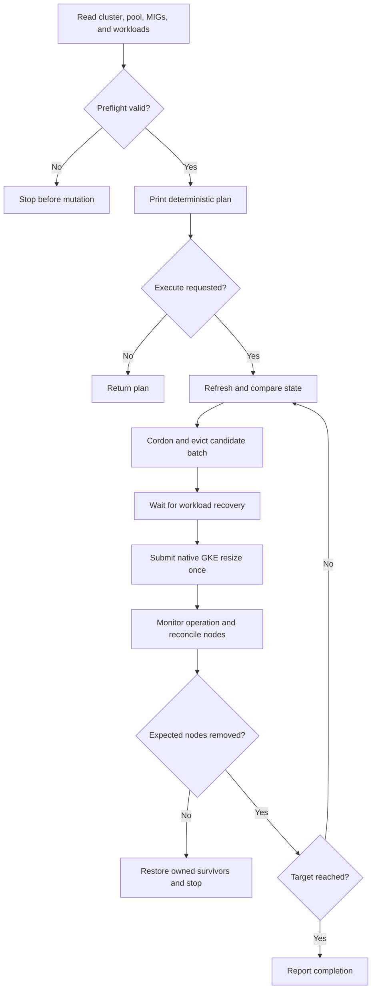

# Design: a GKE-native drain orchestrator

## Problem and scope

Maintenance scale-downs cross two independently changing systems: Kubernetes workload scheduling and cloud VM capacity. A successful eviction does not prove that cloud capacity changed, and a completed cloud resize does not prove that the preferred VMs were the ones removed.

`gke-drain` makes those steps explicit for manually managed GKE Standard node pools. It has a pure planner, an orchestrator behind a small interface, and a REST adapter. The planner and orchestrator can be tested without cloud access.

## Mapping from ECS

| ECS concept | Google Cloud / Kubernetes counterpart | Design consequence |
| --- | --- | --- |
| ECS cluster | GKE Standard cluster | Select project, control-plane location, and cluster explicitly. |
| EC2 container instance | Kubernetes Node backed by a Compute Engine VM | Verify provider ID against the pool's MIG membership. |
| ASG desired capacity | GKE node-pool size | Call `nodePools.setSize`; inspect MIGs read-only. |
| ECS `DRAINING` | Cordon plus `policy/v1` eviction | Wait for Pods to leave; never substitute direct deletion. |
| Service desired task count | Controller replica count | Keep application replica counts unchanged. |
| Exact instance selection | Preferred drained candidates | Compare the actual removals and halt on a mismatch. |
| Instance flip | Native GKE node maintenance / upgrade strategies | Omitted from this scale-down tool. |

GKE owns its node pools' managed instance groups. This implementation follows the documented GKE resize path rather than using Compute writes to obtain stronger-looking victim selection.

## Lifecycle

Errors at each stage follow the recovery rules below. A failed revalidation never advances to a new resize.

## Sizing and selection

GKE applies a node count to every zone in a pool. With three zones, a change from four to two nodes per zone reduces the total from twelve to six. A batch of one per zone first reaches nine total nodes, then six. All zones must start at the same stable size.

The planner obtains current targets from the backing MIGs. `NodePool.initialNodeCount` describes initial configuration and is not used as the current size. Multiple groups in one zone can indicate an upgrade state; ambiguous layouts are refused. Each expected VM must have one matching Kubernetes Node, with no additional nodes in the observed pool.

Within each zone, selection uses a machine-type preference, ordinary Pod count, age, and name. This creates a repeatable preference list, not a scheduling or bin-packing proof. No-op plans at the current size are allowed; scale-ups and zero targets are outside scope.

The initial fingerprint covers the state relevant to the proposed action. Kubernetes resource versions are used when mutating individual nodes, rather than making every harmless heartbeat invalidate a whole plan. The fingerprint is not a signed authorization object and cannot be replayed through a plan-file apply mode.

Execution retains the candidate names and UIDs printed for every batch. It refreshes guarded node fields and repeats safety checks before using them. Pod redistribution can change a hypothetical new ranking after the first drain; that does not silently substitute different candidates into the displayed plan. Changed candidate identity or unexpected capacity stops the run.

